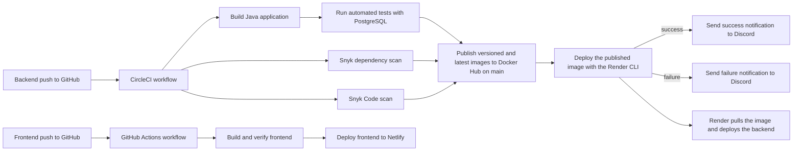
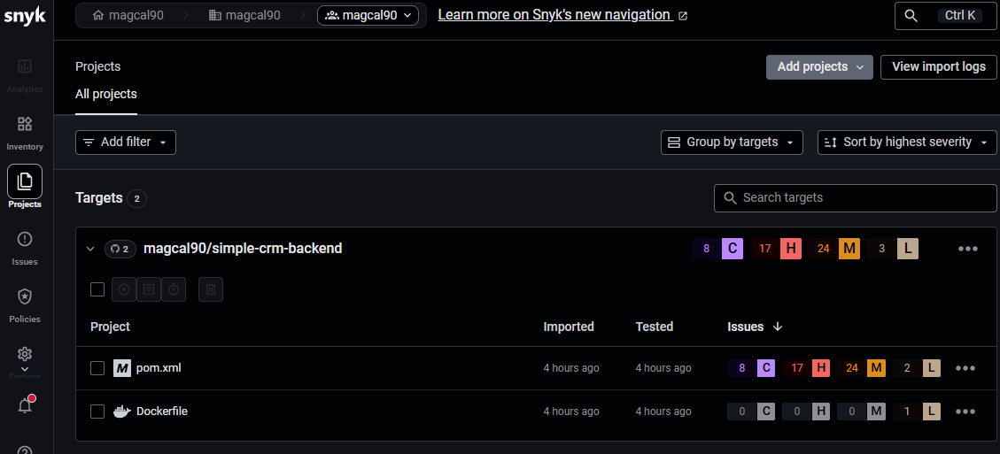
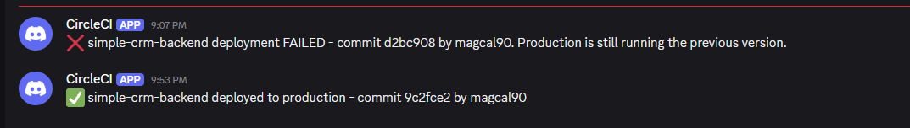
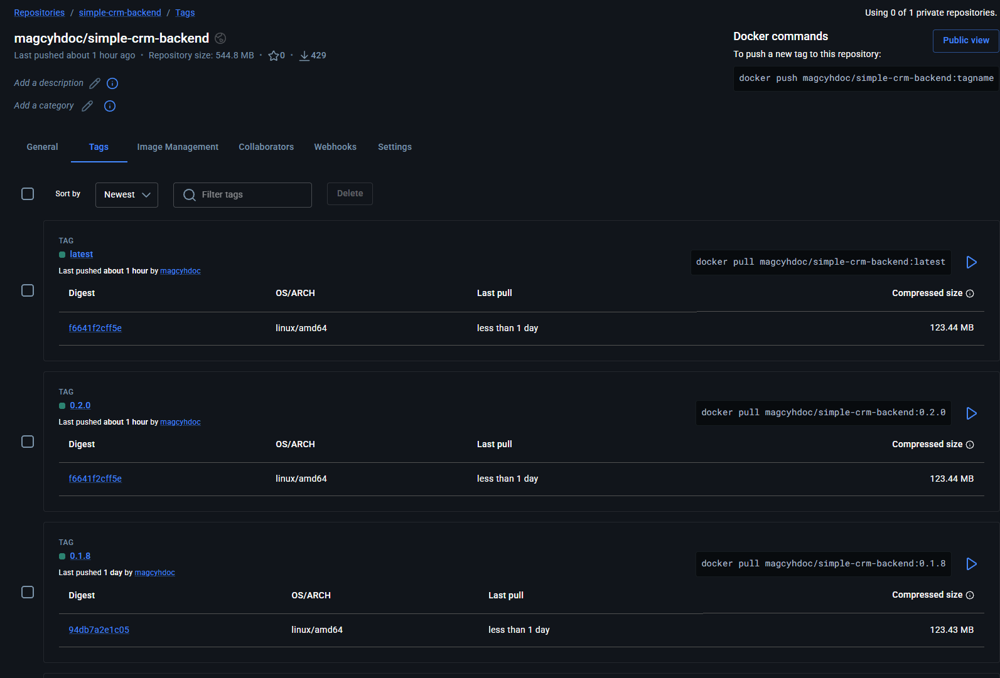
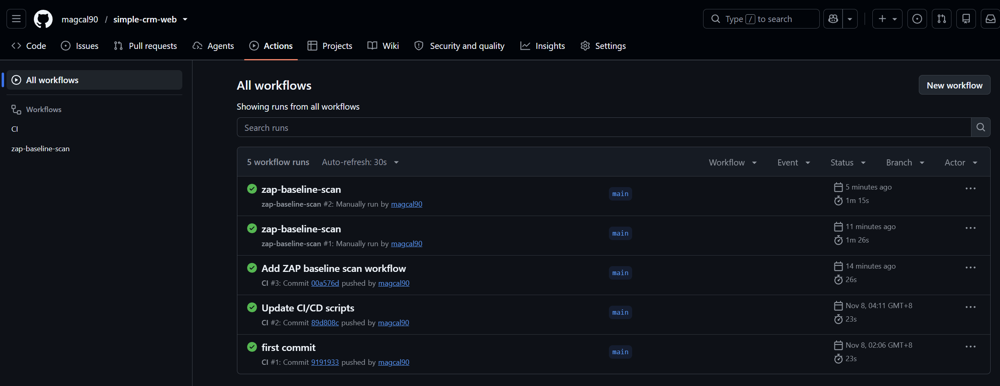
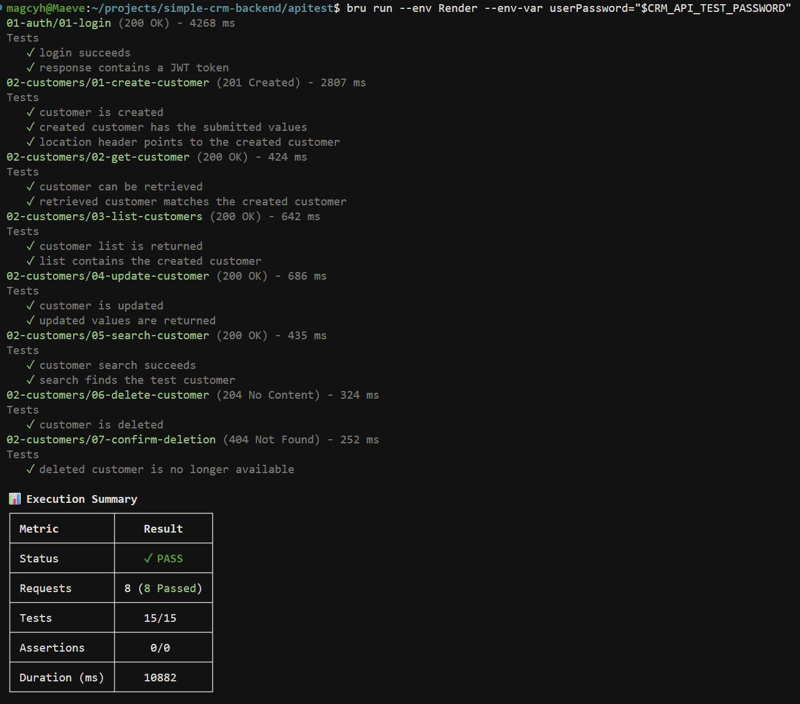

# Simple CRM — Module 4 Assignment Submission

This is a **AIFT01 Module 4 assignment submission**. The implementation uses the Simple CRM backend and frontend instead of TaskFlow.

The submission consists of a Dockerized Java 21 Spring Boot API, a PostgreSQL database, and a React frontend connected to the deployed API. The backend is hosted on Render and the frontend is hosted on Netlify.

## Assignment option coverage

Option 3 is the main submission, with additional work covering Options 1, 2, 4, and 5. The assessment below uses the requirements in the assignment brief and distinguishes complete coverage from partial or equivalent implementations.

| Option | Coverage | Evidence and qualification |
| --- | --- | --- |
| **1 — Add a CI pipeline** | **Complete** | The [CircleCI pipeline](https://app.circleci.com/pipelines/gh/magcal90?useNewPipelines=true) builds the application, runs its tests, and publishes both versioned and `latest` images to [Docker Hub](https://hub.docker.com/r/magcyhdoc/simple-crm-backend) on pushes to `main`. The workflow and successful-run evidence are documented below. |
| **2 — Add a frontend on Netlify** | **Complete** | The [React frontend](https://simple-crm-frontend.netlify.app/login) is deployed on Netlify, calls the public backend API, and is allowed by the backend CORS configuration. A screenshot below shows customer data loaded from the API. |
| **3 — Use the Simple CRM projects** | **Implemented with a deliberate platform substitution** | The Simple CRM backend and frontend were containerized, connected, and deployed with PostgreSQL. Because Railway was unavailable at the time of development, Render was deliberately used as the backend hosting platform; Netlify hosts the frontend. This fulfills the technical scope, with Render replacing the brief's specified Railway platform. |
| **4 — Publish versioned Docker images** | **Complete** | Releases use Semantic Versioning from `release.env`. CircleCI publishes the release tag and moves `latest` to the same build. Docker Hub evidence below shows multiple versioned tags and `latest`; Git tags provide matching release history. |
| **5 — Add security checks** | **Partial / equivalent tooling** | CircleCI runs Snyk dependency scanning and Snyk Code SAST, secrets are supplied through protected environment variables, and the frontend has an OWASP ZAP baseline workflow. This is partial against the exact brief because the backend uses Snyk instead of the specifically requested OWASP Dependency-Check plugin, and no container-image scan is claimed. |

## Submission links

| Resource | URL |
| --- | --- |
| Backend repository | https://github.com/magcal90/simple-crm-backend |
| Live backend API | https://simple-crm-backend-htvk.onrender.com |
| Live frontend | https://simple-crm-frontend.netlify.app/login |
| Docker Hub image | https://hub.docker.com/r/magcyhdoc/simple-crm-backend |
| CircleCI pipeline | https://app.circleci.com/pipelines/gh/magcal90?useNewPipelines=true |
| Frontend repository | https://github.com/magcal90/simple-crm-web |
| Frontend GitHub Actions | https://github.com/magcal90/simple-crm-web/actions |

> **Note :** Due to Railway service limitations at the time of development, I deployed the Dockerized backend to Render instead. The service is publicly accessible using the link above.

> **Before logging in:** Render may put the backend service to sleep after a period of inactivity. Open the [live backend URL](https://simple-crm-backend-htvk.onrender.com) first and wait for the service to wake up, then log in through the frontend. The first request may take longer than usual while Render starts the service.

## CI/CD pipeline

The backend and frontend use separate automated delivery pipelines. A push to each repository starts its respective pipeline.



### Backend: GitHub → CircleCI → Docker Hub → Render

The backend pipeline is defined in [`.circleci/config.yml`](.circleci/config.yml) and runs these jobs:

1. **Build:** CircleCI checks out the GitHub repository, restores the Maven dependency cache, reads the application version from `release.env`, and packages the Spring Boot application with Java 21.
2. **Snyk dependency scan:** Snyk scans the Maven dependencies for known vulnerabilities. The scan uses a high severity threshold, but findings do not fail the job (`fail-on-issues: false`).
3. **Snyk Code scan:** Snyk Code runs static application security testing against the source code. It uses the same high severity threshold and non-blocking findings setting.
4. **Test:** After the build succeeds, CircleCI starts a PostgreSQL 16 service container, waits for it to become ready, and runs the automated Maven test suite. Test reports are retained as CircleCI results and artifacts.
5. **Publish:** Only on `main`, and after the tests and both Snyk jobs succeed, CircleCI builds the production container using the repository's multi-stage `Dockerfile`. It tags the image with both the release version and `latest`, then authenticates and pushes both tags to Docker Hub.
6. **Deploy:** After publishing succeeds, CircleCI installs the Render CLI and authenticates with `RENDER_API_KEY`. It requests a deployment for `RENDER_SERVICE_ID` using the newly published versioned Docker Hub image, then waits for Render to finish the deployment.
7. **Discord notification:** CircleCI posts a success or failure message to Discord based on the result of the Render CLI deploy job. Because the CLI runs with `--wait`, a successful job means Render reported that the deployment completed. Failures before the deploy job do not trigger either notification.

The CircleCI project uses these protected environment values:

| Variable | Purpose |
| --- | --- |
| `DOCKER_USERNAME` | Docker Hub account used to publish the image |
| `DOCKER_TOKEN` | Docker Hub access token used by CircleCI |
| `RENDER_API_KEY` | Render API key used by the Render CLI |
| `RENDER_SERVICE_ID` | Render service identifier targeted by the deploy job |
| `SNYK_TOKEN` | Snyk API token used by the Snyk orb |
| `DISCORD_WEBHOOK_URL` | Discord webhook used to post deployment notifications |

The `docker-hub` context is attached to both the `publish` and `deploy` jobs and provides `DOCKER_USERNAME` and `DOCKER_TOKEN`. `RENDER_API_KEY`, `RENDER_SERVICE_ID`, `SNYK_TOKEN`, and `DISCORD_WEBHOOK_URL` are configured as protected CircleCI project environment variables. Secret values are not stored in the repository.

The `Dockerfile` is used for the deployable production image. `docker-compose.yml` is used locally to run the same backend together with PostgreSQL; it is not part of the CircleCI publish/deploy jobs.

### Frontend: GitHub → GitHub Actions → Netlify

The frontend has a separate repository and delivery pipeline. A frontend push to GitHub triggers its GitHub Actions workflow. The workflow builds and verifies the React application and then deploys the successful build to Netlify. The deployed frontend communicates with the Render backend through its public API URL, with the Netlify origin allowed by the backend CORS configuration.

The exact frontend workflow configuration and its run history are available from the frontend repository and GitHub Actions links above.

### CI/CD evidence

The successful CircleCI workflow completed the build, both Snyk scans, tests, publish, deploy, and success-notification jobs. The failure-notification job was skipped because the deploy job succeeded:


The Snyk project dashboard shows the dependency scan results for the Maven project and Dockerfile. Findings are visible in Snyk; the CircleCI configuration does not fail the pipeline for findings:



The success notification is posted to Discord after the Render CLI deploy job succeeds:



The published Docker Hub repository contains `latest` and versioned image tags:


The Docker Hub tags page shows the current `latest` tag alongside release-versioned images:



Render is configured as an image-based service and shows a successful deployment triggered by CircleCI through the Render CLI. See the single [active backend deployment screenshot](#1-active-backend-deployment) in the deployment evidence below.

The frontend GitHub Actions page shows successful CI runs and OWASP ZAP baseline security scans:



Netlify shows the frontend as published from GitHub:


<details>
<summary>Additional pipeline and deployment configuration evidence</summary>

CircleCI is connected to the backend GitHub repository and reads `.circleci/config.yml`:


The protected deployment variables are configured in CircleCI with their values masked:


The full CircleCI pipeline history includes the successful workflow and earlier development attempts:


</details>

## Deployment evidence for review

The screenshots below provide evidence of the backend deployment, live API, and frontend integration.

### 1. Active backend deployment

This screenshot shows the Render service name, successful deployment status, and public URL. Environment-variable values and secrets are not shown.


### 2. Live backend API working

The Render application log shows the service running at its public URL and successfully retrieving five customers through the deployed backend.


### 3. Frontend connected to the backend

This screenshot shows the Netlify frontend displaying customer data retrieved from the deployed backend API.


### 4. API testing with Bruno

The Bruno API test run provides additional evidence that the deployed backend endpoints were tested successfully.



## Reviewer verification

Before attempting to log in, open [https://simple-crm-backend-htvk.onrender.com](https://simple-crm-backend-htvk.onrender.com) and wait for the Render service to wake up. Then review the frontend using the link under **Submission links**.

If login is required, use the following test account:

| Credential | Value |
| --- | --- |
| Email | `user@example.com` |
| Password | Provided separately in the submission message |

The password is intentionally not stored in this repository. To verify the backend directly, authenticate using the test-account password supplied with the submission:

On the first application start, set `APP_BOOTSTRAP_USER_EMAIL` and
`APP_BOOTSTRAP_USER_PASSWORD`. The application creates the account only when it
does not already exist and persists a BCrypt hash, never the plaintext password.
After that first successful start, the bootstrap variables may be removed.

```bash
curl --request POST \
  --url https://simple-crm-backend-htvk.onrender.com/auth/login \
  --header 'Content-Type: application/json' \
  --data '{"email":"user@example.com","password":"YOUR_DEMO_USER_PASSWORD"}'
```

Copy the `token` value from the response, then call the protected customer API:

```bash
curl --url https://simple-crm-backend-htvk.onrender.com/customers \
  --header 'Authorization: Bearer YOUR_JWT_TOKEN'
```

## Implemented backend API

Base URL: `https://simple-crm-backend-htvk.onrender.com`

Except for login, every endpoint requires an `Authorization: Bearer <token>` header.

| Method | Endpoint | Description | Success status |
| --- | --- | --- | --- |
| `POST` | `/auth/login` | Authenticate with `email` and `password`; returns a JWT | `200 OK` |
| `GET` | `/customers` | List all customers | `200 OK` |
| `POST` | `/customers` | Create a customer | `201 Created` |
| `GET` | `/customers/{id}` | Get one customer | `200 OK` |
| `PUT` | `/customers/{id}` | Replace/update a customer | `200 OK` |
| `DELETE` | `/customers/{id}` | Delete a customer | `204 No Content` |
| `GET` | `/customers/search?firstName={name}` | Search by first name | `200 OK` |
| `GET` | `/customers/{id}/interactions` | List a customer's interactions | `200 OK` |
| `POST` | `/customers/{id}/interactions` | Add an interaction to a customer | `201 Created` |
| `GET` | `/customers/{customerId}/interactions/{interactionId}` | Get one interaction belonging to a customer | `200 OK` |

Customer create/update JSON fields are `firstName`, `lastName`, `email`, `phone`, `company`, `status` (`active` or `inactive`), `tags`, and `notes`. Interaction JSON fields are `remarks`, `interactionDate` (`YYYY-MM-DD`), and `interactionType`.

## Run the submission locally

Docker with Docker Compose is required. From the repository root, copy the example environment file and replace its placeholder secrets:

```bash
cp .env.example .env
```

Start PostgreSQL and the API using the version in `release.env`:

```bash
docker compose --env-file release.env --env-file .env up --build --wait
```

The API is available at `http://localhost:8080`. Stop the containers with:

```bash
docker compose --env-file release.env --env-file .env down
```

The PostgreSQL volume persists after the containers stop. `.env` is ignored by Git; never commit passwords, JWT secrets, or deployment credentials.

## Deployment configuration

### Render image-based backend service

The backend is configured as an image-based Render Web Service using the `latest` image published to Docker Hub. The service is live at the public backend URL, as shown in the [active backend deployment evidence](#1-active-backend-deployment) above.

### Backend environment configuration

The required CORS, JWT, and PostgreSQL connection variables are configured in Render. Their values are masked in the screenshot and no production credentials are committed to Git.


### PostgreSQL database

The backend uses the available Render PostgreSQL 16 database shown below.


## Tests

The test profile uses an in-memory H2 database:

```bash
set -a
. ./release.env
set +a
./mvnw --batch-mode -Drevision="$RELEASE_VERSION" verify
```

## Versioning

`release.env` currently defines `RELEASE_VERSION=0.2.0`. Docker Compose passes it to the build as `APP_VERSION`, and Maven uses it as the application artifact version.

## Use of AI assistance
Generative AI tools were used to assist with test development, documentation, code refactoring, and optimization. The generated suggestions were reviewed, adapted, and validated by the developer.
