# Simple CRM — Module 4 Assignment Submission

This is my **AIFT01 Module 4 assignment submission**. I completed **Option 3**, using my Simple CRM backend and frontend instead of TaskFlow.

The submission consists of a Dockerized Java 21 Spring Boot API, a PostgreSQL database, and a React frontend connected to the deployed API. The backend is hosted on Render and the frontend is hosted on Netlify.

## Submission links

| Resource | URL |
| --- | --- |
| Backend repository | https://github.com/magcal90/simple-crm-backend |
| Live backend API | https://simple-crm-backend-htvk.onrender.com |
| Live frontend | https://simple-crm-frontend.netlify.app/login |
| Docker Hub image | https://hub.docker.com/r/magcyhdoc/simple-crm-backend |
| CircleCI pipeline | https://app.circleci.com/workflow/d9836b95-b779-46db-ac74-7360bd5bc84f |
| Frontend repository | https://github.com/magcal90/simple-crm-web |
| Frontend GitHub Actions | https://github.com/magcal90/simple-crm-web/actions |

> **Note :** Due to Railway service limitations at the time of development, I deployed the Dockerized backend to Render instead. The service is publicly accessible using the link above.

## CI/CD pipeline

The backend and frontend use separate automated delivery pipelines. A push to each repository starts its respective pipeline.

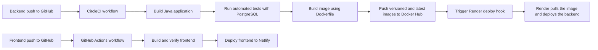

### Backend: GitHub → CircleCI → Docker Hub → Render

The backend pipeline is defined in [`.circleci/config.yml`](.circleci/config.yml) and runs the following jobs:

1. **Build:** CircleCI checks out the GitHub repository, restores the Maven dependency cache, reads the application version from `release.env`, and packages the Spring Boot application with Java 21.
2. **Test:** CircleCI starts a PostgreSQL 16 service container, waits for it to become ready, and runs the automated Maven test suite. Test reports are retained as CircleCI results and artifacts.
3. **Publish:** For a successful build on the `main` branch, CircleCI builds the production container using the repository's multi-stage `Dockerfile`. It tags the image with both the release version and `latest`, then authenticates and pushes both tags to Docker Hub.
4. **Deploy:** After publishing succeeds, CircleCI calls the secret `RENDER_DEPLOY_HOOK`. Render then pulls the latest published backend image and redeploys the service.

The CircleCI project uses these protected environment values:

| Variable | Purpose |
| --- | --- |
| `DOCKER_USERNAME` | Docker Hub account used to publish the image |
| `DOCKER_TOKEN` | Docker Hub access token used by CircleCI |
| `RENDER_DEPLOY_HOOK` | Private Render hook used to start deployment |

These values are configured in CircleCI and are not stored in the repository.

The `Dockerfile` is used for the deployable production image. `docker-compose.yml` is used locally to run the same backend together with PostgreSQL; it is not part of the CircleCI publish/deploy jobs.

### Frontend: GitHub → GitHub Actions → Netlify

The frontend has a separate repository and delivery pipeline. A frontend push to GitHub triggers its GitHub Actions workflow. The workflow builds and verifies the React application and then deploys the successful build to Netlify. The deployed frontend communicates with the Render backend through its public API URL, with the Netlify origin allowed by the backend CORS configuration.

The exact frontend workflow configuration and its run history are available from the frontend repository and GitHub Actions links above.

### CI/CD evidence

The successful CircleCI workflow completed all four backend jobs—build, test, publish, and deploy:

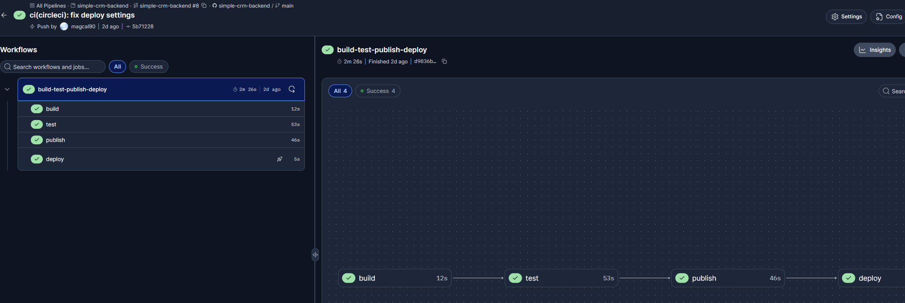

The published Docker Hub repository contains `latest` and versioned image tags:

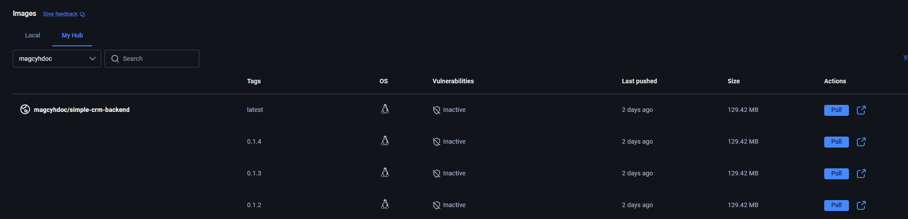

Render is configured as an image-based service and shows a successful deployment triggered through the deploy hook:

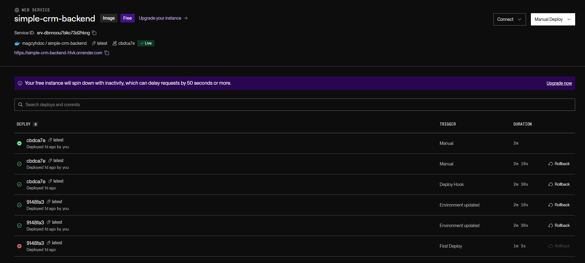

The frontend GitHub Actions verification workflow completed successfully:

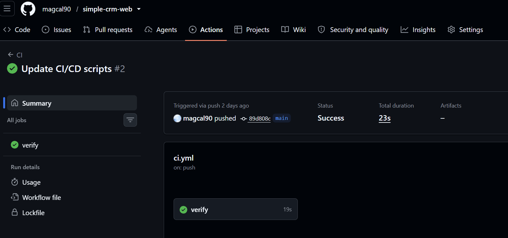

Netlify shows the frontend as published from GitHub:

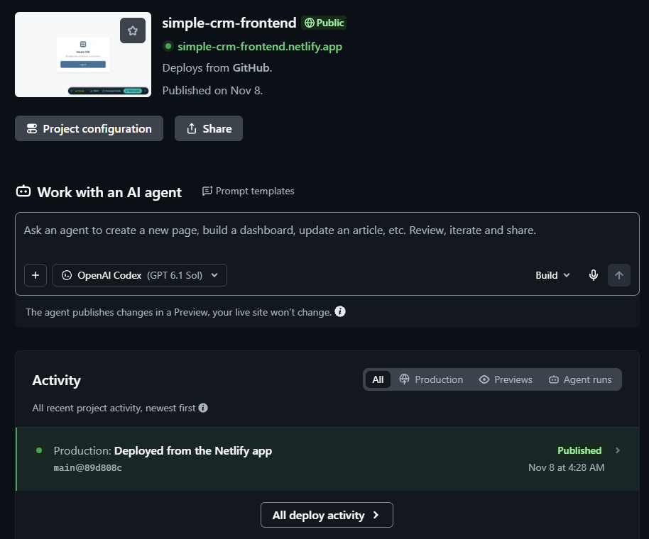

<details>
<summary>Additional pipeline and deployment configuration evidence</summary>

CircleCI is connected to the backend GitHub repository and reads `.circleci/config.yml`:

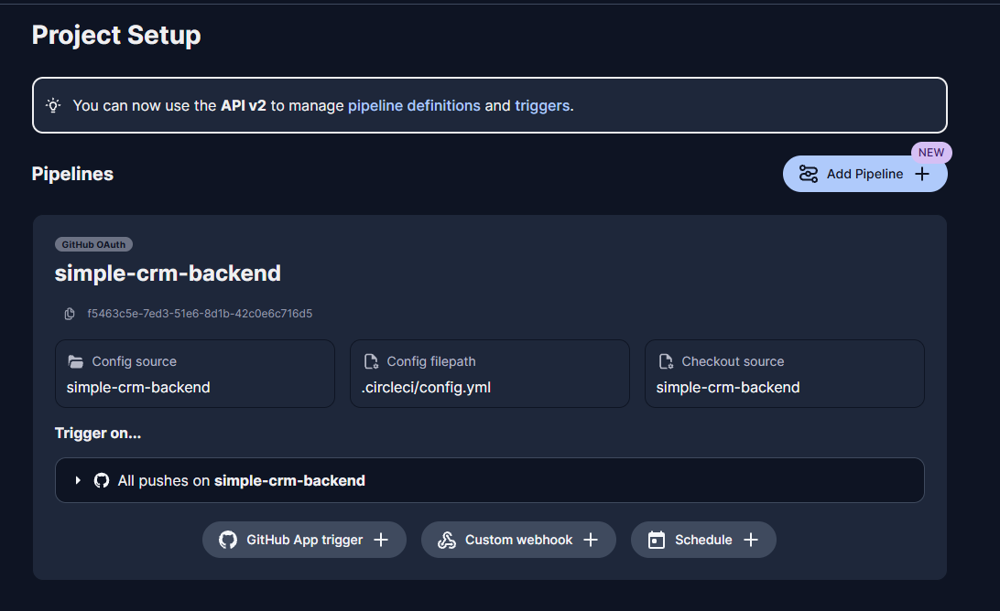

The Render deploy-hook variable is configured in CircleCI with its value masked:

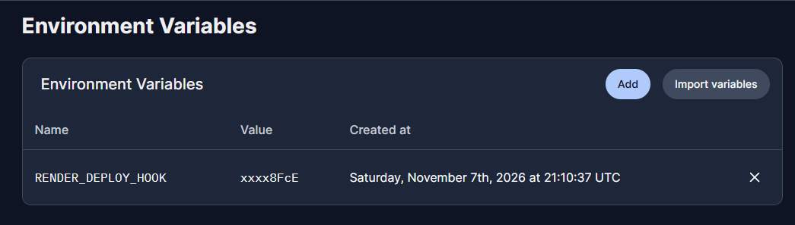

The full CircleCI pipeline history includes the successful workflow and earlier development attempts:

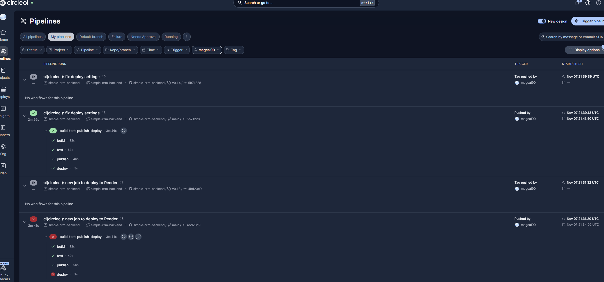

</details>

## Deployment evidence for review

The screenshots below provide evidence of the backend deployment, live API, and frontend integration.

### 1. Active backend deployment

This screenshot shows the Render service name, successful deployment status, and public URL. Environment-variable values and secrets are not shown.


### 2. Live backend API working

The Render application log shows the service running at its public URL and successfully retrieving five customers through the deployed backend.

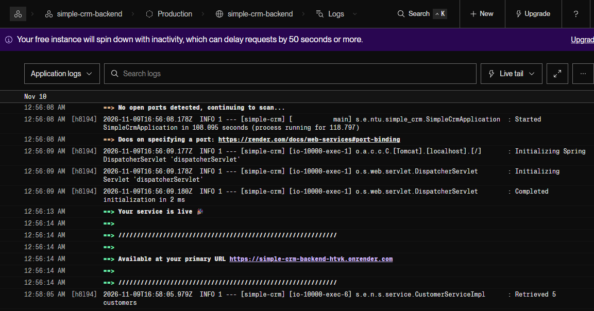

### 3. Frontend connected to the backend

This screenshot shows the Netlify frontend displaying customer data retrieved from the deployed backend API.

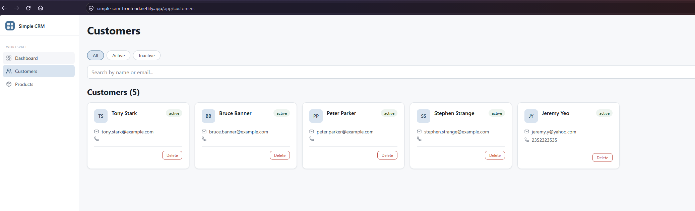

## Reviewer verification

The frontend can be reviewed using the link under **Submission links**. To verify the backend directly, authenticate using the demo-user password supplied separately with the submission:

```bash
curl --request POST \
  --url https://simple-crm-backend-htvk.onrender.com/auth/login \
  --header 'Content-Type: application/json' \
  --data '{"email":"user@example.com","password":"YOUR_DEMO_USER_PASSWORD"}'
```

Copy the `token` value from the response, then call the protected customer API:

```bash
curl --url https://simple-crm-backend-htvk.onrender.com/customers \
  --header 'Authorization: Bearer YOUR_JWT_TOKEN'
```

## Implemented backend API

Base URL: `https://simple-crm-backend-htvk.onrender.com`

Except for login, every endpoint requires an `Authorization: Bearer <token>` header.

| Method | Endpoint | Description | Success status |
| --- | --- | --- | --- |
| `POST` | `/auth/login` | Authenticate with `email` and `password`; returns a JWT | `200 OK` |
| `GET` | `/customers` | List all customers | `200 OK` |
| `POST` | `/customers` | Create a customer | `201 Created` |
| `GET` | `/customers/{id}` | Get one customer | `200 OK` |
| `PUT` | `/customers/{id}` | Replace/update a customer | `200 OK` |
| `DELETE` | `/customers/{id}` | Delete a customer | `204 No Content` |
| `GET` | `/customers/search?firstName={name}` | Search by first name | `200 OK` |
| `GET` | `/customers/{id}/interactions` | List a customer's interactions | `200 OK` |
| `POST` | `/customers/{id}/interactions` | Add an interaction to a customer | `201 Created` |
| `GET` | `/customers/{customerId}/interactions/{interactionId}` | Get one interaction belonging to a customer | `200 OK` |

Customer create/update JSON fields are `firstName`, `lastName`, `email`, `phone`, `company`, `status` (`active` or `inactive`), `tags`, and `notes`. Interaction JSON fields are `remarks`, `interactionDate` (`YYYY-MM-DD`), and `interactionType`.

## Run the submission locally

Docker with Docker Compose is required. From the repository root, copy the example environment file and replace its placeholder secrets:

```bash
cp .env.example .env
```

Start PostgreSQL and the API using the version in `release.env`:

```bash
docker compose --env-file release.env --env-file .env up --build --wait
```

The API is available at `http://localhost:8080`. Stop the containers with:

```bash
docker compose --env-file release.env --env-file .env down
```

The PostgreSQL volume persists after the containers stop. `.env` is ignored by Git; never commit passwords, JWT secrets, or deployment credentials.

## Deployment configuration

### Render image-based backend service

The backend is configured as an image-based Render Web Service using the `latest` image published to Docker Hub. The service is live at the public backend URL.


### Backend environment configuration

The required CORS, JWT, and PostgreSQL connection variables are configured in Render. Their values are masked in the screenshot and no production credentials are committed to Git.

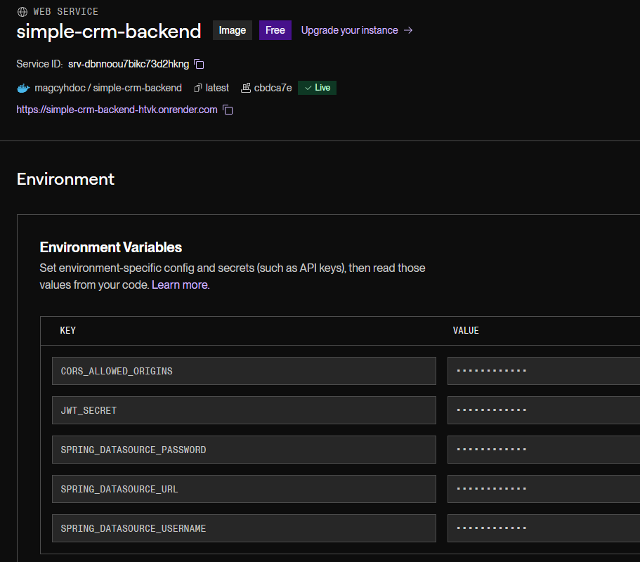

### PostgreSQL database

The backend uses the available Render PostgreSQL 16 database shown below.

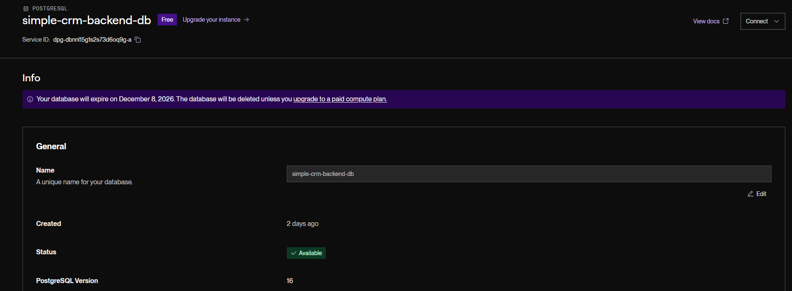

## Tests

The test profile uses an in-memory H2 database:

```bash
set -a
. ./release.env
set +a
./mvnw --batch-mode -Drevision="$RELEASE_VERSION" verify
```

## Assignment requirements and submission status

- [x] Simple CRM selected as Option 3.
- [x] Multi-stage `Dockerfile` added at the repository root.
- [x] Docker Compose configuration added for the API and PostgreSQL.
- [x] CircleCI configured to build and test the backend.
- [x] CircleCI configured to publish versioned and `latest` images to Docker Hub.
- [x] CircleCI configured to trigger the Render deployment after publication.
- [x] Frontend delivery configured through GitHub Actions and Netlify.
- [x] Backend source code pushed to GitHub.
- [x] Backend deployed publicly on Render.
- [x] Frontend deployed publicly on Netlify.
- [ ] Confirm acceptance of Render as the hosting platform instead of Railway.
- [x] Add deployment screenshots showing the active Render backend and PostgreSQL database.
- [x] Add CI/CD screenshots showing CircleCI, Docker Hub, GitHub Actions, and Netlify.
- [x] Add a screenshot showing the frontend populated from the live backend API.
- [x] Add the direct URL of a successful CircleCI workflow under **Submission links**.
- [ ] Complete a final check of the GitHub, backend, and frontend links.
- [ ] Commit and push the final README and screenshot files.

## Known deviation and issues

- **Hosting platform:** The backend is hosted on Render rather than Railway because of Railway service limitations at the time of development.
- **Errors or failures:** There are no unresolved application, test, or deployment failures at the time of submission.

## Versioning

`release.env` currently defines `RELEASE_VERSION=0.1.4`. Docker Compose passes it to the build as `APP_VERSION`, and Maven uses it as the application artifact version.
